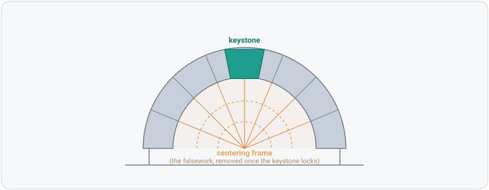

# Centina

Most building traditions have a word for the temporary frame that holds an arch up while it's being built. The frame carries the stones until the keystone drops in, and then it's taken down and the arch stands on its own. In English it's called centering, or falsework. German calls it *Lehrgerüst*, literally "teaching frame," because the frame teaches the arch its shape. French calls it *cintre*; Spanish, *cimbra*. This project takes its name from the Italian, *centina*, the word for the frames behind Brunelleschi's dome. The builders of the Renaissance didn't treat those frames as incidental carpentry. Building them well was an engineering discipline in its own right.

<p align="center">
  <picture>
    <source media="(prefers-color-scheme: dark)" srcset="docs/assets/falsework-dark.svg">
    
  </picture>
</p>

**Centina** is TypeScript repurposed for writing specs. You use it to write structured, rule-checked pseudocode (falsework) for a coding task before anyone builds it. TypeScript supplies the grammar, but it doesn't get the final word. That belongs to Centina's own spec-plane checker, because a spec isn't done when it compiles. It's done when every gap left in it is there on purpose and has somewhere to go.

Like the frame under an arch, a spec comes first and gives the implementation its shape. It's scaffolding, not product, and it doesn't pretend otherwise.

## Documentation

The full documentation is at **[adamtwede.github.io/centina](https://adamtwede.github.io/centina/)**: why this exists, the concepts, install, a quickstart, the vocabulary, and the design rationale.

## Install

Centina is a Claude Code plugin. From a clone of this repo:

```console
node install.mjs
```

This copies the plugin to `~/.claude/skills/centina/`, which Claude Code loads in every session. Then start Claude Code in the project you want to spec and run `/centina-session-zero`. For other harnesses, or setups without Claude Code, see the [install pages](https://adamtwede.github.io/centina/install-other-harnesses).

## Quick usage examples

- A [worked example](/using-it#a-walkthrough-one-seam-from-prose-to-spec-complete) from the documentation.
- The foundational example, the [hill-climbing-loop](https://github.com/adamtwede/centina/blob/main/specs/hill-climbing-loop/hill-climbing-loop.centina.ts). (While this might look like regular code, it is not! All function bodies are type-checked *psuedocode*.)
- A complete skeleton spec for a simple mobile app called [Woodboard](https://github.com/adamtwede/centina/tree/main/specs/wordboard) to help you remember new words you encounter. No function bodies, just the DAG in code. Start with [ARCHITECTURE.md](https://github.com/adamtwede/centina/blob/main/specs/wordboard/ARCHITECTURE.md).
- An in-progress `session-zero` for a [turn-based strategy video game](https://github.com/adamtwede/centina/tree/main/specs/turnball), no skeleton spec yet. Demonstrates the recursive nature of software design and document/session management strategy.

## Contributing

See [CONTRIBUTING.md](CONTRIBUTING.md).
