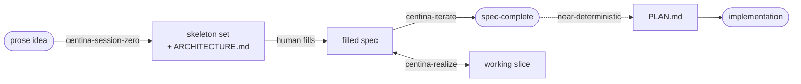
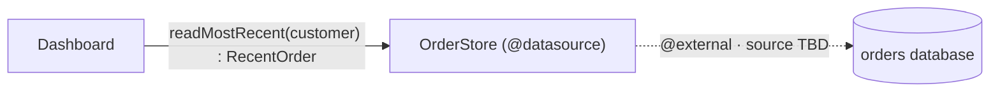

# Using it

## How to actually use it

### Gap-hunting sessions

Four project skills drive Centina as a collaborative, gated process. The first two are **gap-hunting** sessions: their job is to help a human architect pin down structure while making every unresolved decision *visible* as a routed hole rather than an invisible guess. The third, `centina-realize`, does the coding work a spec needs before it can be written with confidence, and the fourth, `centina-spike`, runs the experiments it hands off. All four record their decisions in the system [ledger](ledger.md).

- **[centina-session-zero](https://github.com/adamtwede/centina/blob/main/skills/centina-session-zero/SKILL.md)** — turns a prose idea for a whole system into a component DAG, a skeleton spec set, and an `ARCHITECTURE.md`, one gated phase at a time.
- **[centina-iterate](https://github.com/adamtwede/centina/blob/main/skills/centina-iterate/SKILL.md)** — refines one spec toward clean, settling each diagnostic with you, then derives `PLAN.md`.
- **[centina-realize](https://github.com/adamtwede/centina/blob/main/skills/centina-realize/SKILL.md)** — plans and builds a working slice behind a spec's boundaries, handing each spike to `centina-spike`.
- **[centina-spike](https://github.com/adamtwede/centina/blob/main/skills/centina-spike/SKILL.md)** — runs one bounded experiment line that a spec cannot settle without code, against a gate you set in advance.

Crucially, "fit" is treated as a **jurisdiction map, not a verdict**. A realization-dominated responsibility (an algorithm, a physics loop, a rendering step) is never *rejected* from a spec — it is *routed behind a door* (a terminal, a delegated Skill, or a held `deferred<"unimplemented">` hole), and the spec keeps the typed seam around it. Even an idea that turns out to be "one algorithm, not a system" yields a minimal skeleton that is explicit about its remit rather than a bounced request. The value is in *localizing* the realization into a named, bounded hole.

Every node gets read on two planes, and where its center of gravity sits decides how it is routed:

| Plane | What it captures | Where it lands in a spec |
|---|---|---|
| **Structural** | relationships between named data: provenance, flow, contract ("*X* comes from *Y*, in shape *Z*") | a filled-in component |
| **Realization** | the carrying-out: algorithm, dynamics, aesthetics; no nameable data relationship | routed behind a door: a terminal, a Skill, or a held hole |

The lineage: **`ARCHITECTURE.md` + skeleton set** (session-zero) → each **`<component>.centina.ts`** filled in, in cycles of iterate and realize that grow a **working slice** → **`PLAN.md`** per boundary-set (the implementation).



> [!TIP]
> **A word on models and effort level:** Accurately gauging which model and thinking/effort 
> level to use in any agentic coding session is part experience and part trial-and-error. Centina 
> is no different in that respect, but strong directives in the skills and project docs should prevent 
> your agent from trying to tackle too much at once. Centina is designed from first principles to 
> guide you through recursively breaking your project up into manageable chunks, an approach 
> that aligns both human and AI model along the same axis. 
> 
> Start somewhere near the middle, and if your agent seems to be missing important details, 
> dial it up. Otherwise, leave it alone or dial it down and watch for any degradation in performance.

### A walkthrough: one seam, prose to spec-complete

To ground the two skills, follow a single seam of that same order dashboard, the one whose prose hid three decisions, through both stages. (Heavily condensed; a real session is many more exchanges.)

**The prose seed.** The human opens `centina-session-zero` with a sentence:

> "A signed-in customer sees a dashboard with their most recent order and its
> status."

**Session-zero elicits the shape, gate by gate** — it _draws structure out_ and presents the choices, something coding agents are really good at, aiding the human developer in weighing the tradeoffs against their stated priorities, _without_ allowing the agent to simply make the decisions and run with them:

- *Intent (phase 1):* restated back in the human's own terms, ratified.
- *Components (phase 2):* the human names two nodes: a **Dashboard**
  orchestrator and an **OrderStore** it reads from. (The agent resists naming
  the store first; the human draws it.)
- *Seam (phase 3):* the door from Dashboard into OrderStore: a read (non-`void`
  return). Then the highest-yield question, *what happens on the empty /
  not-found case?*, forces exactly the three decisions the prose smuggled past:
  **no orders** returns an explicit empty result, not null; *"recent"* sorts by
  **when the order was placed**; a **cancelled** order still counts, a **draft**
  does not. Each is ratified into the contract.
- *Terminal (phase 4):* OrderStore terminates at the existing orders database —
  an `@external` edge, concrete source TBD, *recorded, not fabricated*.

The ratified DAG — two components, one typed seam, one terminal:



**Session-zero emits the skeleton** — typed seam, routed holes, no bodies.
`shared.centina.ts` carries the ratified vocabulary:

```ts
export enum OrderStatus { PLACED, SHIPPED, DELIVERED, CANCELLED }

// The order as the dashboard needs it. `placedAt` is the sort key (phase 3);
// there is no DRAFT — drafts are deliberately not orders here (phase 3).
export type Order = { id: string; status: OrderStatus; placedAt: number }

// The empty case is a first-class shape, not a null (phase 3).
export type RecentOrder = Order | "none"
```

and the boundary declarator states the door, its direction inferred from the
return type:

```ts
/** @datasource The store of placed orders, backed by existing order data. */
export declare class OrderStore {
  // Most recent by `placedAt`; "none" when the customer has no qualifying order.
  readMostRecent(customer: string): RecentOrder
}
```

The one thing the human has *not* settled, that is, whether a cancelled order surfaces with its own banner or folds into the normal view, ships as a hole, never a guess:

```ts
// In dashboard.centina.ts. Routing still undecided → the checker flags it.
export const presentOrder = deferred<(order: RecentOrder) => DashboardView>()
```

`npm run check` reports that hole and the `DashboardView` name it leans on but
nothing yet defines:

```console
$ npm run check -- specs/order-dashboard/dashboard.centina.ts
  [warning] hole-enumeration  :12 — deferred<...>() hole — routing still owed
  [error]   tsc               :12 — cannot find name 'DashboardView'
```

That is the handoff: **interfaces present and concrete, one decision held.**

**The human fills, then runs the centina-iterate skill.** Later the human resolves the held question: cancelled orders get their own view — and writes it in themselves (the agent holds no pen past the skeleton). They open `centina-iterate`, and the checker surfaces the residue one item at a time:

- `DashboardView` is referenced but undefined → the human adds its shape.
- the `deferred` hole's routing is still owed (a warning) → the human commits it
  to `deferred<"open", …>`, the implementer's discretion, since banner-vs-fold
  is a rendering call, not a contract.

Re-check: clean. The spec is **spec-complete** — every gap deliberate, typed, and routed. `PLAN.md` now follows near-deterministically, and the three decisions the prose would have buried are on the record, made by the person who should have made them.

> [!TIP]
> The mental model in two sentences: **you decide *what*; the agent, with your
> express approval at every critical juncture, decides *how*.** Nothing that
> matters is left to chance.
