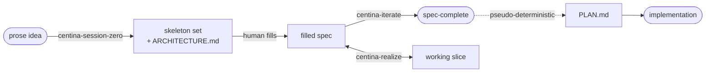
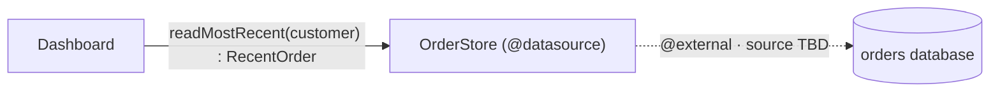

# Using it

## How to actually use it

### The four skills

Centina is driven by four skills, each of which runs as a collaborative, gated process. The first two are **gap-hunting** sessions. Their job is to help you, the architect, pin down the structure, and to make every decision you haven't made yet *visible* as a routed hole instead of an invisible guess. The third, `centina-realize`, does the coding a spec sometimes needs before you can write it with confidence. The fourth, `centina-spike`, runs the experiments that realize hands off. All four record their decisions in the system [ledger](/ledger).

- **[centina-session-zero](https://github.com/adamtwede/centina/blob/main/skills/centina-session-zero/SKILL.md)** takes a prose idea for a whole system and turns it into a component DAG, a set of skeleton specs, and an `ARCHITECTURE.md`, one gated phase at a time.
- **[centina-iterate](https://github.com/adamtwede/centina/blob/main/skills/centina-iterate/SKILL.md)** refines a single spec until it's clean, settling each diagnostic with you, and then derives `PLAN.md` from it.
- **[centina-realize](https://github.com/adamtwede/centina/blob/main/skills/centina-realize/SKILL.md)** plans and builds a working slice behind a spec's boundaries, and hands each spike off to `centina-spike`. Not meant to act as production implementation, but rather to hone the spec.
- **[centina-spike](https://github.com/adamtwede/centina/blob/main/skills/centina-spike/SKILL.md)** runs one bounded line of experiments, for a question the spec can't settle without code, measured against a gate you set before it starts.

### Fit is a map, not a verdict

One thing worth understanding early is how session-zero handles fit. It treats fit as a question of jurisdiction, not a yes-or-no verdict. Say part of your system is mostly realization: an algorithm, a physics loop, a rendering step. Centina doesn't reject that from the spec. It routes it behind a door (a terminal, a delegated `Skill`, or a held `deferred<"unimplemented">` hole), and the spec keeps the typed seam around it. Even an idea that turns out to be "one algorithm, not a system" still gets a minimal skeleton that's explicit about what it covers, instead of being bounced back to you. The value is in pinning the realization down into a named, bounded hole.

To decide where something belongs, every node gets read on two planes, and wherever its center of gravity sits decides how it's routed:

| Plane           | What it captures                                                                                                                  | Where it lands in a spec                                   |
| --------------- | --------------------------------------------------------------------------------------------------------------------------------- | ---------------------------------------------------------- |
| **Structural**  | Relationships between named data: where it comes from, where it flows, what the contract is ("*X* comes from *Y*, in shape *Z*"). | A filled-in component.                                     |
| **Realization** | The carrying-out: algorithm, dynamics, aesthetics. No nameable data relationship.                                                 | Routed behind a door: a terminal, a Skill, or a held hole. |

### From prose to implementation

The whole lineage goes like this. Session-zero produces an `ARCHITECTURE.md` and a skeleton set. Each `<component>.centina.ts` in that set gets filled in, through cycles of iterate and realize that grow a working slice along the way. Then each boundary-set gets a `PLAN.md`, and that drives the implementation:



> [!TIP]
> **A word on models and effort level:** figuring out which model and
> thinking/effort level to use in any agentic coding session is part
> experience and part trial and error. Centina is no different in that
> respect, but strong directives in the skills and project docs should keep
> your agent from trying to tackle too much at once. Centina is designed from
> first principles to guide you through recursively breaking your project into
> manageable chunks, an approach that lines the human and the model up along
> the same axis.
>
> Start somewhere near the middle. If your agent seems to be missing important
> details, dial it up. Otherwise, leave it alone, or dial it down and watch for
> any drop in performance.

### A walkthrough: one seam, from prose to spec-complete

To make the first two skills concrete, let's follow a single seam through both of them. It's the order dashboard from [Why](/why#the-practical-failure-over-competence), the one whose single sentence hid three decisions. (This is heavily condensed. A real session has many more exchanges.)

**The prose seed.** You open `centina-session-zero` with a sentence:

> "A signed-in customer sees a dashboard with their most recent order and its
> status."

**Session-zero draws out the shape, one gate at a time.** It pulls the structure out of you and lays out the choices, which is something coding agents are genuinely good at. It helps you weigh the tradeoffs against the priorities you've stated, *without* letting the agent just make the calls and run with them.

- *Intent (phase 1):* the agent restates your intent back to you in your own
  terms, and you ratify it.
- *Components (phase 2):* you name two nodes, a **Dashboard** orchestrator and
  an **OrderStore** it reads from. (The agent holds back from naming the store
  first. You draw it.)
- *Seam (phase 3):* the door from Dashboard into OrderStore is a read, since it
  has a non-`void` return. Then comes the question that pays off the most:
  *what happens in the empty, not-found case?* That one question forces exactly
  the three decisions the prose let slip by. **No orders** returns an explicit
  empty result, not null. *"Recent"* sorts by **when the order was placed**. A
  **cancelled** order still counts; a **draft** doesn't. You ratify each one
  into the contract.
- *Terminal (phase 4):* OrderStore ends at the existing orders database. That's
  an `@external` edge with the concrete source still TBD. It's recorded, not
  made up.

The ratified DAG has two components, one typed seam, and one terminal:



**Session-zero writes the skeleton:** a typed seam, routed holes, and no bodies.
`shared.centina.ts` carries the vocabulary you ratified:

```ts
export enum OrderStatus { PLACED, SHIPPED, DELIVERED, CANCELLED }

// The order as the dashboard needs it. `placedAt` is the sort key (phase 3);
// there is no DRAFT — drafts are deliberately not orders here (phase 3).
export type Order = { id: string; status: OrderStatus; placedAt: number }

// The empty case is a first-class shape, not a null (phase 3).
export type RecentOrder = Order | "none"
```

and the boundary declaration states the door, with its direction inferred from
the return type:

```ts
/** @datasource The store of placed orders, backed by existing order data. */
export declare class OrderStore {
  // Most recent by `placedAt`; "none" when the customer has no qualifying order.
  readMostRecent(customer: string): RecentOrder
}
```

There's one thing you haven't settled yet: whether a cancelled order gets its own banner or folds into the normal view. That ships as a hole, never a guess:

```ts
// In dashboard.centina.ts. Routing still undecided → the checker flags it.
export const presentOrder = deferred<(order: RecentOrder) => DashboardView>()
```

`npm run check` reports that hole, along with the `DashboardView` name it relies
on that nothing defines yet:

```console
$ npm run check -- specs/order-dashboard/dashboard.centina.ts
specs/order-dashboard/dashboard.centina.ts:11:62 - error TS2304: Cannot find name 'DashboardView'.

11 export const presentOrder = deferred<(order: RecentOrder) => DashboardView>()
                                                                ~~~~~~~~~~~~~


/path/to/project/specs/order-dashboard/dashboard.centina.ts
  [warning] hole-enumeration :11 — deferred<...>() hole — routing not yet resolved
```

The first block is `tsc`'s own error; the second is Centina's spec-plane rules.

That's the handoff. The interfaces are there and concrete, and one decision is being held.

**You fill it in, then run `centina-iterate`.** Later, you settle the part of the held question that matters to the contract: a cancelled order has to look visibly different from a live one. You write that into the spec yourself, because the agent doesn't hold the pen past the skeleton. Then you open `centina-iterate`, and the checker brings up what's left, one item at a time:

- `DashboardView` is referenced but never defined, so you add its shape.
- The `deferred` hole's routing is still owed (a warning). *How* a cancelled
  order gets set apart, whether that's a banner or just different styling, is
  a rendering call, not a contract, so you commit the hole to
  `deferred<"open", …>` and leave it to the implementer.

Re-check: clean. The spec is **spec-complete**, with every gap deliberate, typed, and routed. `PLAN.md` now follows almost deterministically, and the three decisions the prose would have buried are on the record, made by the person who should have made them.

> [!TIP]
> The whole mental model: **you decide *what*; the agent, with your express
> approval at every critical juncture, decides *how*.** Nothing that matters is
> left to chance.
